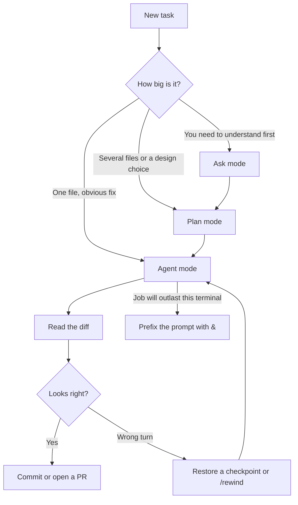

# Cursor Agent Cheatsheet

A reference you can keep next to your work: install the agent, run a session, then shape how it behaves. Commands below match the official docs as of September 2026. If a flag ever disagrees with your install, trust the CLI:

```bash
agent help
agent help <command>
```

Official home: [cursor.com/docs](https://cursor.com/docs) · CLI: [cursor.com/docs/cli/overview](https://cursor.com/docs/cli/overview) · Agent: [cursor.com/docs/agent/overview](https://cursor.com/docs/agent/overview)

---

## The map

Cursor Agent is the same assistant in three places. Pick the place, then the mode.

| Place | Open it | Best for |
| --- | --- | --- |
| Editor | `Cmd/Ctrl+I` sidepane | Editing with the files in front of you |
| Terminal | `agent` | SSH, scripts, tmux, headless CI |
| Cloud | [cursor.com/agents](https://cursor.com/agents), or prefix a CLI message with `&` | Long jobs that keep running after you close the laptop |

An agent is three parts: **instructions** (rules, skills, your prompt), **tools** (read, edit, shell, web, browser, MCP), and a **model**. There is no cap on how many tool calls one task can make.



**Daily card.** These cover most sessions. Everything else is in the tables below.

| You want | Type |
| --- | --- |
| Start a session in this repo | `agent` |
| Start with a task | `agent "fix the failing login test"` |
| Plan before editing | `agent --plan "add password reset"` |
| Read-only answers | `agent --mode=ask "where is auth checked?"` |
| Switch mode mid-chat | `Shift+Tab`, or `/plan`, `/ask`, `/debug` |
| Attach a file or folder | `@path` in the prompt |
| Shrink a long chat | `/summarize` |
| Continue yesterday | `agent resume` or `agent --continue` |
| Let it run in the cloud | `& finish the migration and open a PR` |
| Script or CI | `agent -p "..." --output-format json --trust` |
| See models | `agent models` |
| Update the CLI | `agent update` |

---

## 1. Install

The CLI binary is `agent`. A legacy symlink `cursor-agent` points at the same program. It lives under `~/.local/share/cursor-agent/` and is linked into `~/.local/bin`.

**macOS, Linux, WSL**

```bash
curl https://cursor.com/install -fsS | bash
```

**Windows (PowerShell)**

```powershell
irm 'https://cursor.com/install?win32=true' | iex
```

**Put it on your PATH** if `agent` is not found:

```bash
# bash
echo 'export PATH="$HOME/.local/bin:$PATH"' >> ~/.bashrc
source ~/.bashrc

# zsh
echo 'export PATH="$HOME/.local/bin:$PATH"' >> ~/.zshrc
source ~/.zshrc
```

**Check and update**

```bash
agent --version
agent about          # version, system, account
agent update         # manual update; auto-update is on by default
```

The desktop app is separate: download it from [cursor.com](https://cursor.com). The CLI does not require the app, and the app does not require the CLI. Rules, MCP, and skills are shared when both are installed.

Docs: [Installation](https://cursor.com/docs/cli/installation)

---

## 2. Sign in

Two ways. Use the browser on your own machine. Use an API key in CI and scripts.

```bash
agent login                         # opens the browser
NO_OPEN_BROWSER=1 agent login       # prints a URL instead
agent status                        # same as: agent whoami
agent status --format json
agent logout
```

API keys are created at [cursor.com/dashboard/api](https://cursor.com/dashboard/api).

```bash
export CURSOR_API_KEY=your_api_key_here
agent "implement user authentication"

# or pass it once; prefer the env var so it stays out of shell history
agent --api-key "$CURSOR_API_KEY" "implement user authentication"
```

Docs: [Authentication](https://cursor.com/docs/cli/reference/authentication)

---

## 3. First session

```bash
cd ~/src/your-repo
agent login
agent
```

You are in **Agent** mode: it can read, edit, and run commands. It asks before shell commands (`y` / `n`) unless you have allowed them.

Try this order once, so the modes stick:

1. `agent --mode=ask "explain how requests reach the database"`
2. Exit (`Ctrl+D` twice, or `/quit`), then `agent --plan "add a health check endpoint"`
3. When the plan is right, switch with `Shift+Tab` or start a fresh `agent "implement the plan in @.cursor/plans"` and let it edit.
4. Press `Ctrl+R` to review the diff. `Left` / `Right` change files. `i` adds a follow-up.

Open the same repo in the editor with `/open` (alias `/cursor`).

Docs: [Using Agent in CLI](https://cursor.com/docs/cli/using)

---

## 4. Modes

Same modes in the editor and the CLI.

| Mode | What it does | How to enter |
| --- | --- | --- |
| Agent | Edits files, runs tools, ships the change | Default |
| Plan | Asks questions and writes a plan before coding | `Shift+Tab`, `/plan`, `--plan`, `--mode=plan` |
| Ask | Reads the repo and answers. No edits | `/ask`, `--mode=ask` |
| Debug | Investigates a failure with a debug workflow | `/debug` |

`Shift+Tab` rotates Agent, Plan, and Ask.

Use Plan when the blast radius is unclear: a migration, a new subsystem, anything that touches more than a couple of files. Use Ask when you want a map of the code. Use Agent when you already know the change.

A **custom mode** is a skill that stays on. In the `/` menu, `Enter` attaches a skill to one message. `Option+Enter` keeps that skill active until you leave it.

`/goal` gives the agent one long-lived objective and keeps it working until that objective is done. In the CLI, `Ctrl+C` pauses the goal. `/goal` is still rolling out; if it is missing, open a new chat.

```text
/goal fix all flaky tests and make CI green
```

Docs: [Agent overview](https://cursor.com/docs/agent/overview) · [CLI overview](https://cursor.com/docs/cli/overview)

---

## 5. While a session is running

### CLI keys

| Key | Action |
| --- | --- |
| `Shift+Tab` | Rotate Agent / Plan / Ask |
| `Shift+Enter` | New line in iTerm2, Ghostty, Kitty, Warp, and Zed |
| `Ctrl+J` | New line everywhere, including tmux |
| `\` then `Enter` | New line everywhere, no setup |
| `Option+Enter` | New line after `/setup-terminal` (Apple Terminal, Alacritty, VS Code) |
| `Up` | Previous prompts |
| `Ctrl+R` | Review changes. `i` to comment, arrows to move |
| `Enter` while it works | Steer at the next safe boundary |
| `Enter` again | Interrupt the current turn |
| `Ctrl+D` `Ctrl+D` | Exit |
| `@` | Attach a file, folder, or rule |
| `&` at the start of a message | Hand the task to a Cloud Agent |

Run `/setup-terminal` if multiline input feels wrong. tmux and screen swallow `Shift+Enter`, so use `Ctrl+J` there. Docs: [Terminal setup](https://cursor.com/docs/cli/reference/terminal-setup).

### Editor keys

| Key | Action |
| --- | --- |
| `Cmd/Ctrl+I` | Open Agent |
| `Cmd/Ctrl+K` | Inline edit. User Rules do not apply here |
| `Enter` while Agent works | Queue the message until the task finishes |
| `Cmd+Enter` | Send now and redirect the current turn |
| `Enter` twice, or Send now | Steer at the next tool call without cutting off in-flight work |
| `Cmd/Ctrl+K` in the Agents Window | Search past transcripts |
| `Cmd/Ctrl+F` | Find in the open conversation |
| `/side` or `/btw` | Side chat that does not interrupt the main thread |

Drag queued messages to reorder them. A side chat keeps its own transcript and can see the parent thread. `@`-mention that side chat later to pull the result back.

### Checkpoints

The editor saves a checkpoint before large edits. Click a checkpoint in the timeline to preview, then restore. Restoring puts files back. It does not delete chat messages. Checkpoints are local and are not Git. Commit when you want the change to last.

Docs: [Agent overview](https://cursor.com/docs/agent/overview)

---

## 6. CLI commands

Global flags work with any command.

| Flag | Meaning |
| --- | --- |
| `-p, --print` | Non-interactive. Prints the answer. Still has write and shell tools |
| `--output-format text\|json\|stream-json` | With `--print`. Default `text` |
| `--stream-partial-output` | Stream text deltas. Needs `--print` and `stream-json` |
| `--model <id>` | Model for this run |
| `--mode plan\|ask` | Start in that mode. Agent is the default |
| `--plan` | Same as `--mode=plan` |
| `--resume [chatId]` | Resume a chat. Omit the id with the `resume` command for the latest |
| `--continue` | Resume the previous session (`--resume=-1`) |
| `-w, --worktree [name]` | Edit in a new git worktree, not your current checkout |
| `--worktree-base <ref>` | Base the worktree on this branch or ref. Default: `HEAD` |
| `--skip-worktree-setup` | Skip scripts in `.cursor/worktrees.json` |
| `--workspace <dir>` | Repo root. Default: current directory |
| `-f, --force` / `--yolo` | Run allowed commands without prompts, unless a deny rule blocks them |
| `--sandbox enabled\|disabled` | Sandbox on or off for this run |
| `--approve-mcps` | Approve every MCP server |
| `--trust` | Trust the workspace without a prompt. Headless only |
| `--api-key <key>` | Auth for this process. Prefer `CURSOR_API_KEY` |
| `-H, --header "Name: Value"` | Extra request header. Repeatable |
| `--plugin-dir <dir>` | Load a local plugin. Repeatable |
| `--list-models` | List models |
| `-v, --version` / `-h, --help` | Version and help |

| Command | What it does |
| --- | --- |
| `agent [prompt...]` | Interactive Agent, optional first prompt |
| `agent login` / `logout` | Sign in or clear credentials |
| `agent status` / `whoami` | Account status. `--format text\|json` |
| `agent about` | Version, system, account. `--format text\|json` |
| `agent models` | Models on this account |
| `agent mcp …` | MCP servers. See [MCP](#11-mcp) |
| `agent sandbox …` | Sandbox config, or run one command inside it |
| `agent worker …` | Private worker that runs cloud agents on your machine |
| `agent acp` | ACP server on stdio for a custom client. Hidden from default help |
| `agent update` | Update the CLI |
| `agent ls` | Pick a past chat and resume it |
| `agent resume` | Resume the latest chat |
| `agent create-chat` | Create an empty chat and print its id |
| `agent generate-rule` / `agent rule` | Interactive rule generator |
| `agent install-shell-integration` | Add shell integration to `~/.zshrc` |
| `agent uninstall-shell-integration` | Remove it |
| `agent help [command]` | Help |

```bash
# interactive
agent
agent "refactor the auth module to use JWT"

# plan, then a named worktree so main stays clean
agent --plan "design the billing split"
agent --worktree billing "implement the billing split and open a PR"
agent --workspace ~/src/my-app --worktree auth-fix "fix the flaky auth test"

# come back later
agent ls
agent resume
agent --continue
agent --resume="chat-id-here"
```

Worktrees are created under `~/.cursor/worktrees/<repo>/<name>`, next to editor worktrees. Cursor cleans them up with the same retention rules as the editor.

Docs: [Parameters](https://cursor.com/docs/cli/reference/parameters) · [Using the CLI](https://cursor.com/docs/cli/using)

---

## 7. Slash commands

Type `/` in an interactive session. `[arg]` is optional.

| Command | What it does |
| --- | --- |
| `/model [filter]` | Pick a model. `Tab` edits the filter |
| `/plan [prompt]` | Plan mode, show the plan, or send a plan prompt |
| `/ask` | Ask mode |
| `/debug [prompt]` | Debug mode |
| `/goal [objective]` | Long-lived objective. Rolling out |
| `/run-everything [on\|off\|status]` | Run Everything. Alias `/auto-run` |
| `/max-mode` | Max Mode on legacy request-based plans |
| `/sandbox` | Sandbox and network menu |
| `/shell [command]` | Shell mode. Aliases `/sh`, `/run` |
| `/mcp [list\|list-tools] [id]` | MCP servers and their tools |
| `/plugin [subcommand]` | Plugins and marketplaces |
| `/config` | Interactive settings |
| `/resume` | Recent chats |
| `/clear` | New chat. Aliases `/new`, `/new-chat`, `/newchat` |
| `/fork` | Fork this chat |
| `/rename <name>` | Name the session |
| `/summarize` | Compress context. Alias `/compress` |
| `/rewind` | Jump back to an earlier message |
| `/copy` | Copy a previous user message |
| `/copy-request-id` | Copy the last request id |
| `/copy-conversation-id` | Copy the conversation id |
| `/about` | Version and account, also copied |
| `/logs` | Debug log path, copied |
| `/open` | Open the git root in Cursor. Alias `/cursor` |
| `/vim` | Vim keys |
| `/line-numbers` | Line numbers in code blocks |
| `/show-thinking` | Thinking blocks |
| `/status-indicators` | Status in the terminal title |
| `/setup-terminal` | Newline keybindings |
| `/update` | Update the CLI |
| `/logout` | Sign out |
| `/quit`, `/exit` | Leave |
| `/help [command]` | Help |
| `/feedback <text>` | Send feedback |
| `/bedrock [subcommand]` | Bedrock, when that feature is enabled |

Skills show up in the same menu. `Enter` applies one to the next message. `Option+Enter` pins it as a custom mode.

Docs: [Slash commands](https://cursor.com/docs/cli/reference/slash-commands)

---

## 8. Context

The model only sees what you put in front of it. Attach the few files that matter, and write the outcome you want.

| Gesture | Effect |
| --- | --- |
| `@src/auth.ts` | Include that file |
| `@src/auth/` | Include that folder |
| `@rule-name` | Pull in a manual rule |
| `/summarize` | Replace older turns with a summary when the window fills up |
| Image files | PNG, JPG, GIF, WebP, and SVG can be read by vision-capable models |

Good prompts name the outcome, the boundary, and how you will check it:

```text
Add a /health endpoint that returns 200 when the database ping succeeds.
Touch only src/server.ts and its test. Run the test suite and stop when it passes.
```

Ask mode is the right first step when you do not know those paths yet.

---

## 9. Permissions, sandbox, approval

Three run modes:

| Mode | Behavior | Turn it on |
| --- | --- | --- |
| Allowlist | Prompt unless the command is allowed | Default, and `/config` |
| Auto-review | Allowlisted calls run, sandboxed calls run in the sandbox, the rest are classified or prompted | `--auto-review`, `/auto-review`, `/config` |
| Run Everything | Commands run unless a deny rule blocks them | `/run-everything on`, `--force` |

Deny wins over allow.

**Where settings live**

| Scope | Path | What you can set |
| --- | --- | --- |
| Global | `~/.cursor/cli-config.json` (Windows: `%USERPROFILE%\.cursor\cli-config.json`) | Everything |
| Project | `<repo>/.cursor/cli.json` | Permissions only |
| Linux/BSD alt | `$XDG_CONFIG_HOME/cursor/cli-config.json` | Global, if `XDG_CONFIG_HOME` is set |
| Override dir | `CURSOR_CONFIG_DIR` | Point the CLI at another config directory |

```json
{
  "version": 1,
  "editor": { "vimMode": false },
  "approvalMode": "auto-review",
  "permissions": {
    "allow": [
      "Shell(ls)",
      "Shell(git)",
      "Shell(npm)",
      "Read(src/**/*.ts)",
      "Write(src/**)",
      "WebFetch(docs.github.com)",
      "WebFetch(*.github.com)",
      "Mcp(github:*)"
    ],
    "deny": [
      "Shell(rm)",
      "Read(.env*)",
      "Read(**/.env*)",
      "Write(**/*.key)",
      "Write(**/.env*)"
    ]
  }
}
```

| Token | Gates |
| --- | --- |
| `Shell(git)` | First token of the command. `Shell(curl:*)` also matches arguments |
| `Read(src/**/*.ts)` | File reads. Globs: `*`, `**`, `?` |
| `Write(src/**)` | File writes |
| `WebFetch(*.github.com)` | Domains the fetch tool may call. `*` is every domain |
| `Mcp(server:tool)` | One MCP tool. `Mcp(server:*)` is the whole server |

Relative globs stay inside the workspace. Absolute paths can point outside it.

**Sandbox**

```bash
agent sandbox enable
agent sandbox disable      # fall back to allowlist prompts
agent sandbox reset
/sandbox                   # interactive menu, including network

agent sandbox run --network npm test
agent sandbox run --allow-paths /tmp/build --readonly-paths /etc/hosts ls
```

| `sandbox run` flag | Effect |
| --- | --- |
| `--allow-paths <a,b>` | Extra read/write paths |
| `--readonly-paths <a,b>` | Extra read-only paths |
| `--blocked-patterns <globs>` | Gitignore-style blocks |
| `--network` | Network inside the sandbox. Default off |
| `--sb-debug` | Write sandbox logs and print the folder |

Sandboxed commands go through a default-deny network proxy. Team admins can set a network allowlist that the CLI enforces.

`sudo` prompts in the CLI with a masked password. The password goes to `sudo` over a local channel. The model does not see it.

If a config file will not load:

```bash
mv ~/.cursor/cli-config.json ~/.cursor/cli-config.json.bad
```

The CLI recreates a valid file. JSON only, no comments.

Docs: [Permissions](https://cursor.com/docs/cli/reference/permissions) · [Configuration](https://cursor.com/docs/cli/reference/configuration)

---

## 10. Rules, skills, hooks, subagents

Instructions stack. When two rules conflict, earlier sources win: **Team → Project → User**. All of them are merged into the prompt. Rules apply to Agent chat, not to Tab autocomplete and not to inline edit (`Cmd/Ctrl+K`).

### Rules

| Kind | Where | Use |
| --- | --- | --- |
| Project | `.cursor/rules/*.mdc` | Shared with the repo. Must be `.mdc` |
| User | Customize → Rules | Your tone and habits, every project |
| Team | Cursor dashboard | Org standards. Enforced rules cannot be turned off |
| Plain instructions | `AGENTS.md` | Simple markdown. Nested files apply in that directory |

The CLI also reads `AGENTS.md` and `CLAUDE.md` at the project root.

| `alwaysApply` | `description` | `globs` | When it loads |
| --- | --- | --- | --- |
| `true` | | | Every chat |
| `false` | | set | When a matching file is in context |
| `false` | set | | When the agent judges it relevant |
| `false` | | | Only if you `@` mention it |

```md
---
description: API error shape
alwaysApply: false
---

- Validate at the service boundary.
- Return `{ code, message }`. Do not throw raw strings.
```

```md
---
globs: src/components/**/*.tsx
alwaysApply: false
---

- Named exports only.
- Keep a component under 200 lines.
```

Multiple globs are comma-separated: `docs/**/*.md, docs/**/*.mdx`.

Create one with `/create-rule`, or `agent generate-rule`, or Customize → Rules → Add Rule. Keep each rule short, one concern, and point at a real file with `@template.ts` instead of pasting the template into the rule. Add a rule when the agent repeats a mistake. Do not add one for habits a linter already enforces.

Nested `AGENTS.md` files combine with parents. The closer file wins.

Docs: [Rules](https://cursor.com/docs/rules)

### Skills

A skill is a folder with `SKILL.md`. The agent can pull it in on its own, or you invoke it with `/skill-name`.

| Scope | Path |
| --- | --- |
| Personal | `~/.cursor/skills/<name>/SKILL.md` |
| Project | `.cursor/skills/<name>/SKILL.md` |

Do not put your own skills in `~/.cursor/skills-cursor/`. Cursor manages that directory.

```md
---
name: ship-checklist
description: Use when preparing a branch to open a pull request.
disable-model-invocation: true
---

# Ship checklist

1. Run the test script in package.json.
2. Read the diff and list risk.
3. Stop before pushing unless the user asked to push.
```

`disable-model-invocation: true` makes it slash-command only. Leave it off when the agent should notice the skill from the description.

Optional extras in the skill folder: `reference.md`, `examples.md`, `scripts/`.

Create one with `/create-skill`. `/migrate-to-skills` converts old “apply intelligently” rules and slash-command files into skills.

The `/` menu is the live list. These builtins are the ones you will reach for:

| Skill | Use |
| --- | --- |
| `/create-rule` | Write a project rule |
| `/create-skill` | Write a skill |
| `/create-hook` | Write a hook |
| `/create-subagent` | Write a custom subagent |
| `/automate` | Build a Cursor Automation |
| `/loop` | Run a prompt or skill on a repeating interval |
| `/canvas` | Interactive visual next to the chat |
| `/review`, `/review-bugbot` | Review the diff before you push |
| `/review-security` | Security review of local changes |
| `/onboard` | Short setup interview |
| `/shell` | Run the rest of the line as a literal shell command |
| `/sdk` | Help writing `@cursor/sdk` or `cursor-sdk` code |

Docs: [Skills](https://cursor.com/docs/skills)

### Hooks

Hooks are scripts. Cursor sends JSON on stdin and reads JSON on stdout. They can observe, block, or rewrite a step.

| Scope | Config | Scripts run from |
| --- | --- | --- |
| Project | `.cursor/hooks.json` | Repo root. Paths like `.cursor/hooks/check.sh` |
| User | `~/.cursor/hooks.json` | `~/.cursor/` |

Cloud agents run project hooks from the repo. They do not see `~/.cursor/hooks.json`.

| Event | Typical use |
| --- | --- |
| `sessionStart` / `sessionEnd` | Set up or audit a session |
| `beforeSubmitPrompt` | Block a prompt that contains a secret |
| `beforeShellExecution` / `afterShellExecution` | Allow, deny, or log commands |
| `beforeReadFile` / `afterFileEdit` | Guard reads, format after writes |
| `beforeMCPExecution` / `afterMCPExecution` | Guard MCP calls |
| `preToolUse` / `postToolUse` / `postToolUseFailure` | Any tool |
| `subagentStart` / `subagentStop` | Allow or chain subagents |
| `preCompact` | Watch context compression |
| `stop` | Run something when the agent finishes |
| `afterAgentResponse` / `afterAgentThought` | Log output |
| `beforeTabFileRead` / `afterTabFileEdit` | Tab autocomplete only |
| `workspaceOpen` | App lifecycle, not an agent session |

```json
{
  "version": 1,
  "hooks": {
    "beforeShellExecution": [
      { "command": ".cursor/hooks/block-dangerous.sh" }
    ]
  }
}
```

Create one with `/create-hook`. Docs: [Hooks](https://cursor.com/docs/hooks)

### Subagents

A subagent is a focused assistant with its own context. The parent delegates to it so exploration does not fill the main chat. In the CLI they run locally, inherit your credentials, rules, and approval policy, and show live status.

| Scope | Path | Priority |
| --- | --- | --- |
| Project | `.cursor/agents/<name>.md` | Higher |
| User | `~/.cursor/agents/<name>.md` | Lower |

```md
---
name: code-reviewer
description: Reviews diffs for bugs, security, and missing tests. Use after code changes.
---

When invoked, read the git diff first. Report only concrete issues, ordered by severity.
```

`name` is lowercase and hyphenated. If you omit it, Cursor uses the filename. The `description` is what the parent uses to decide when to delegate. Say “use proactively” in the description if you want that. Optional frontmatter: `model` (`inherit` or a model id), `readonly: true` (no writes and no state-changing shell), and `is_background: true`.

Docs: [Subagents](https://cursor.com/docs/subagents)

### Plugins

A plugin bundles rules, skills, agents, commands, hooks, and MCP servers.

| Format | Manifest |
| --- | --- |
| Cursor plugin | `.cursor-plugin/plugin.json` |
| Agent plugin (open standard) | `plugin.json` at the plugin root |

Install from Customize, or load a local directory with `--plugin-dir`. `/plugin` manages plugins inside the CLI.

Docs: [Plugins](https://cursor.com/docs/reference/plugins)

---

## 11. MCP

MCP connects the agent to external tools. The CLI and the editor read the same files. Project config wins, then global, then configs discovered in parent directories.

| Scope | File |
| --- | --- |
| Project | `.cursor/mcp.json` |
| User | `~/.cursor/mcp.json` |
| Team | Dashboard → Integrations & MCP |

```json
{
  "mcpServers": {
    "server-name": {
      "type": "stdio",
      "command": "npx",
      "args": ["-y", "mcp-server"],
      "env": { "API_KEY": "${env:API_KEY}" },
      "envFile": ".env"
    }
  }
}
```

| Field | Required | Role |
| --- | --- | --- |
| `type` | yes for stdio | `stdio` for a local process. HTTP and SSE are the remote transports |
| `command` | yes for stdio | Executable on `PATH`, or a full path |
| `args` | no | Arguments |
| `env` | no | Environment for that process |
| `envFile` | no | `.env` path. `${workspaceFolder}` is allowed |

```bash
agent mcp list
agent mcp list-tools playwright
agent mcp login github
agent mcp enable github
agent mcp disable github

# skip MCP approval prompts for this run
agent --approve-mcps "query production errors from the last hour"
```

Inside a session: `/mcp list`, `/mcp list-tools <id>`, `/mcp enable <id>`. Names with spaces work.

Allow tools in the permission file with `Mcp(server:tool)` so headless runs do not stall. See [Permissions](#9-permissions-sandbox-approval).

MCP is for tools the agent calls. ACP (`agent acp`) is the other direction: your program talks to the agent over stdio JSON-RPC.

Browse servers in Customize, or at [cursor.directory](https://cursor.directory). Docs: [MCP](https://cursor.com/docs/mcp) · [CLI MCP](https://cursor.com/docs/cli/mcp)

---

## 12. Cloud, review, automations

### Hand off from the CLI

Start a message with `&`. The cloud agent keeps going. Pick it up at [cursor.com/agents](https://cursor.com/agents), on the desktop Cloud dropdown, or in the iOS app.

```text
& refactor the auth module and add tests
```

Cloud agents clone the repo into an isolated VM, install dependencies, and can run hooks from `.cursor/hooks.json`. They can use team MCP servers. They do not see your home directory, so user rules files and user hooks on your laptop stay local.

Other ways to start one:

| From | How |
| --- | --- |
| Desktop | Cloud in the dropdown under the agent input |
| Web / iOS | [cursor.com/agents](https://cursor.com/agents) |
| Slack, Linear | `@cursor` |
| GitHub PR or issue, Bitbucket PR | `@cursor` |
| API / SDK | Cloud runtime. See [Scripts and SDK](#13-scripts-ci-and-the-sdk) |

A **private worker** runs those cloud agents on your own machine instead of Cursor’s VM. Useful when the repo needs your network or hardware.

```bash
agent worker debug          # auth, privacy, routing
agent worker start --name build-box --worker-dir ~/src/my-app
agent worker start --pool --pool-name default
```

| Flag | Meaning |
| --- | --- |
| `--worker-dir <path>` | Workspace to expose. Repeatable. The first is the identity |
| `--auth-token-file <path>` | Worker token file |
| `--management-addr <addr>` | `/healthz`, `/readyz`, `/metrics` |
| `--label k=v` / `--labels-file <path>` | Labels. File can also be `CURSOR_WORKER_LABELS_FILE` |
| `--name <name>` | Display name. Default: hostname |
| `--pool` | Join a pool. One agent claims the worker at a time. `--single-use` is the old name |
| `--pool-name <name>` | Pool label. Default `default` |
| `--idle-release-timeout <sec>` | Disconnect after idle. `0` disables it |
| `--computer-use` | Let the agent drive this desktop |
| `--verbose` / `--debug` | Startup logs |

Docs: [Cloud Agents](https://cursor.com/docs/cloud-agent) · [Workers](https://cursor.com/docs/cli/reference/parameters)

### Review before and after you push

| When | What to run |
| --- | --- |
| On your branch, before push | `/review` or `/review-bugbot` in the agent, editor, CLI, or cursor.com/agents |
| On the pull request | Bugbot reviews each update. Comment `cursor review` or `bugbot run` to trigger it |
| A Bugbot finding | “Fix in Cursor” opens the IDE. “Fix in Web” opens a cloud agent |
| Autofix | A cloud agent can patch findings on a new branch, or on the existing branch (capped so it cannot loop) |

Bugbot and autofix settings live in the dashboard. Autofix spends Cloud Agent usage.

Docs: [Bugbot](https://cursor.com/docs/bugbot)

### Automations

An automation is a cloud agent on a schedule or on an event from GitHub, GitLab, Slack, Linear, or a webhook. Create one in the Agents Window, at [cursor.com/automations](https://cursor.com/automations), or with `/automate`.

Cursor-managed agents on that page include Bugbot, Security Agents, and PR routing. `/loop` is the local cousin: it re-runs a prompt or skill in this session until you stop it.

Docs: [Automations](https://cursor.com/docs/cloud-agent/automations)

---

## 13. Scripts, CI, and the SDK

Print mode is for shells and pipelines. It can still edit files and run commands. Pass `--trust` so a prompt does not wait for a human, and pass `--force` only when the allowlist is already tight.

```bash
export CURSOR_API_KEY="$CURSOR_API_KEY"

agent -p "find and fix the flaky test in src/auth" \
  --model "gpt-5" \
  --output-format text \
  --trust

agent -p "review the git diff for security issues" \
  --output-format json \
  --trust

# stream tokens as JSON events
agent -p "summarize the failing CI log" \
  --output-format stream-json \
  --stream-partial-output
```

| Format | You get |
| --- | --- |
| `text` | The final answer |
| `json` | One structured result, easier to parse |
| `stream-json` | Events as they happen |

Headless runs wait for subagents to finish before they exit.

For a real integration, use the SDK instead of scraping the CLI. TypeScript package: `@cursor/sdk`. Python package: `cursor-sdk` (`cursor_sdk`). Both are beta. Concepts match: `Agent.prompt` for one shot, `Agent.create` plus `send` for a conversation, `Agent.resume` to continue later. Cloud ids are prefixed with `bc-`. Always set `local` or `cloud` explicitly. Local is the default if you set neither, which is a quiet surprise when you wanted the cloud.

```typescript
import { Agent } from "@cursor/sdk";

const result = await Agent.prompt("Refactor src/utils.ts for readability", {
  apiKey: process.env.CURSOR_API_KEY!,
  model: { id: "composer-2.5" },
  local: { cwd: process.cwd() },
});
```

A thrown `CursorAgentError` means the run never started (auth, config, network). A result whose status is `error` means the run started and failed.

Docs: [TypeScript SDK](https://cursor.com/docs/sdk/typescript) · [Python SDK](https://cursor.com/docs/sdk/python)

---

## 14. Recipes

Each recipe is a full loop: mode, command, then what you check.

### Learn a repo

```bash
agent --mode=ask "Walk me through the request path from the HTTP entrypoint to the database. Name the files."
```

Stay in Ask until you can point at the files. Then `@` those files in the implementation prompt.

### Fix a bug

```bash
agent "The checkout test fails when the cart is empty.
Reproduce it, fix the cause, and show me the test that now covers that case."
```

If it wanders, `Ctrl+R` to see the diff, or restore a checkpoint in the editor. `/rewind` jumps the conversation back.

### Design, then build

```bash
agent --plan "Split billing into invoices and payments. Ask before choosing a schema."
# read the plan, answer the questions, then:
agent "Implement the plan we just agreed. Do not widen the scope."
```

### Risky change off to the side

```bash
agent --worktree upgrade "upgrade the test runner and fix broken snapshots"
```

Your current branch stays untouched. Review the worktree, then merge or open a PR.

### Review your own diff

```text
/review-bugbot
```

Or, from a clean shell:

```bash
agent -p "review the current git diff for bugs and security issues" \
  --output-format text --trust
```

### Hand a long job to the cloud

```text
& migrate the remaining class components under src/ui to functions.
Open a PR and summarize breaking changes in the PR body.
```

### Make the agent stop repeating a mistake

```text
/create-rule
When a test fails, run that test file only before the full suite.
Always apply.
```

Commit `.cursor/rules/` with the code it describes.

### CI comment

```yaml
- name: Cursor review
  env:
    CURSOR_API_KEY: ${{ secrets.CURSOR_API_KEY }}
  run: |
    agent -p "Review the diff for this PR. Report bugs only." \
      --output-format text \
      --trust \
      --sandbox enabled
```

Keep `--force` off in CI until `permissions.deny` covers secrets and destructive commands.

---

## 15. Configuration quick reference

`~/.cursor/cli-config.json` fields you will actually set:

| Field | Values | Why |
| --- | --- | --- |
| `version` | `1` | Schema version |
| `editor.vimMode` | boolean | Vim keys. `/vim` toggles for the session |
| `permissions.allow` / `deny` | token list | What can run without a prompt |
| `approvalMode` | `allowlist`, `auto-review`, `unrestricted` | The three run modes |
| `sandbox.mode` / `sandbox.networkAccess` | strings | Persist sandbox choices |
| `model` | object | Chosen model. `/model` writes this |
| `maxMode` | boolean | Max Mode preference |
| `notifications` | boolean | Ping when the agent finishes or needs you |
| `hints` | boolean | Hints while it works |
| `rewind` | boolean | Enable `/rewind` |
| `suggestNextPrompt` | boolean | Offer a follow-up after each turn |
| `display.showLineNumbers` | boolean | Numbers in code blocks |
| `display.showThinkingBlocks` | boolean | Show thinking |
| `display.showStatusIndicators` | boolean | Terminal title status |
| `attribution.attributeCommitsToAgent` | boolean | “Made with Cursor” commit trailer. Default on |
| `attribution.attributePRsToAgent` | boolean | Same for PR bodies. Default on |
| `network.useHttp1ForAgent` | boolean | HTTP/1.1 for proxies that break HTTP/2 |
| `statusLine` | `{ type, command, padding }` | Custom status above the prompt. See below |

**Proxy**

```bash
export HTTP_PROXY=http://your-proxy:port
export HTTPS_PROXY=http://your-proxy:port
export NODE_USE_ENV_PROXY=1
export NODE_EXTRA_CA_CERTS=/path/to/corporate-ca.pem
```

For proxies that cannot do HTTP/2 (some Zscaler setups), set `network.useHttp1ForAgent` to `true`.

**Status line.** A command receives session JSON on stdin. Its stdout is drawn above the prompt.

```json
{
  "statusLine": {
    "type": "command",
    "command": "~/.cursor/statusline.sh",
    "padding": 2
  }
}
```

`updateIntervalMs` defaults to `300`. `timeoutMs` defaults to `2000`.

Docs: [Configuration](https://cursor.com/docs/cli/reference/configuration)

---

## 16. Layout of a mature repo

```text
repo/
├── AGENTS.md                      # short, always-on instructions
├── .cursor/
│   ├── rules/
│   │   ├── testing.mdc            # globs or alwaysApply
│   │   └── api.mdc
│   ├── skills/
│   │   └── ship-checklist/SKILL.md
│   ├── agents/
│   │   └── code-reviewer.md
│   ├── hooks.json
│   ├── hooks/block-dangerous.sh
│   ├── mcp.json                   # project tools, no secrets committed
│   ├── cli.json                   # project permission allow/deny only
│   └── worktrees.json             # optional setup for new worktrees
└── src/
```

Personal pieces stay in your home directory: `~/.cursor/cli-config.json`, `~/.cursor/mcp.json`, `~/.cursor/skills/`, `~/.cursor/agents/`, `~/.cursor/hooks.json`.

---

## 17. When something breaks

| Symptom | What to try |
| --- | --- |
| `agent: command not found` | Add `~/.local/bin` to `PATH`, then open a new shell |
| Not authenticated | `agent login`, or export `CURSOR_API_KEY` |
| Browser never opens | `NO_OPEN_BROWSER=1 agent login` and open the URL |
| MCP server missing | `agent mcp list`, then `agent mcp enable <id>` and `agent mcp login <id>` |
| Headless run sits forever | It is waiting for approval. Add `--trust`, an allowlist entry, or `--approve-mcps` |
| Commands blocked in CI | A deny rule is winning, or sandbox network is off. `agent sandbox run --network …` to confirm |
| Config will not parse | `mv ~/.cursor/cli-config.json ~/.cursor/cli-config.json.bad` and restart |
| Corporate proxy / stream errors | Set `HTTP_PROXY` and `network.useHttp1ForAgent` |
| Context feels lost | `/summarize`, or start a new chat with `/clear` and `@` the files that matter |
| Wrong edits | Restore a checkpoint, or `/rewind`, then narrow the prompt |
| Rules ignored | File must be `.mdc`. Check `alwaysApply`, `globs`, and `description`. Ask-mode `@` the rule to force it |
| CLI and docs disagree | `agent help <command>` wins |

Debug log path: `/logs`.

---

## 18. Doc index

| Topic | Page |
| --- | --- |
| Install | https://cursor.com/docs/cli/installation |
| CLI overview | https://cursor.com/docs/cli/overview |
| Using the CLI | https://cursor.com/docs/cli/using |
| Parameters and commands | https://cursor.com/docs/cli/reference/parameters |
| Slash commands | https://cursor.com/docs/cli/reference/slash-commands |
| Terminal setup | https://cursor.com/docs/cli/reference/terminal-setup |
| Authentication | https://cursor.com/docs/cli/reference/authentication |
| Permissions | https://cursor.com/docs/cli/reference/permissions |
| Configuration | https://cursor.com/docs/cli/reference/configuration |
| CLI MCP | https://cursor.com/docs/cli/mcp |
| CLI changelog | https://cursor.com/docs/cli/changelog |
| Agent in the editor | https://cursor.com/docs/agent/overview |
| Rules | https://cursor.com/docs/rules |
| Skills | https://cursor.com/docs/skills |
| Hooks | https://cursor.com/docs/hooks |
| Subagents | https://cursor.com/docs/subagents |
| MCP | https://cursor.com/docs/mcp |
| Plugins | https://cursor.com/docs/reference/plugins |
| Cloud Agents | https://cursor.com/docs/cloud-agent |
| Automations | https://cursor.com/docs/cloud-agent/automations |
| Bugbot | https://cursor.com/docs/bugbot |
| TypeScript SDK | https://cursor.com/docs/sdk/typescript |
| Python SDK | https://cursor.com/docs/sdk/python |
| Full docs map | https://cursor.com/llms.txt |
| API keys | https://cursor.com/dashboard/api |
| Agents web app | https://cursor.com/agents |
| Automations web app | https://cursor.com/automations |

All docs pages: [cursor.com/llms.txt](https://cursor.com/llms.txt).
